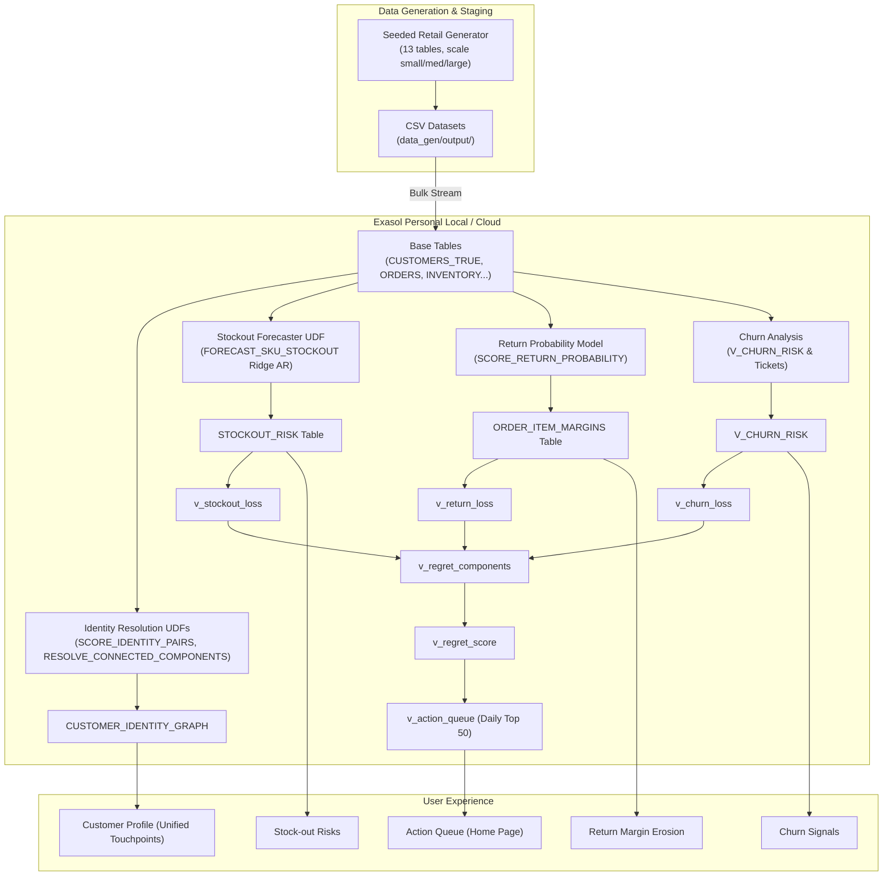

# Regret Radar

Retail enterprises suffer silent margin and revenue leakages across fragmented customer touchpoints, where stock-outs prevent purchases, avoidable returns erode profitability, and unresolved customer friction leads to quiet churn. **Regret Radar** solves this by unifying fragmented customer identities directly inside Exasol and calculating an actionable, rupee-denominated **Regret Score** across stock-outs, return propensity, and ticket churn signals to deliver a ranked, high-impact daily action queue for retail operators.

---

## 1. Architecture & Core Workflow



---

## 2. Prerequisites & Environment Setup

- **Python Version**: 3.11+ (tested on Python 3.13)
- **Database**: Exasol Personal (Local or Cloud)
- **Operating System**: Windows (PowerShell) / Linux / macOS

### Installation

```powershell
# 1. Install dependencies
pip install -r requirements.txt
pip install -e ".[dev]"

# 2. Configure environment credentials
# Copy .env.example to .env and configure connection parameters
cp .env.example .env
```

Ensure `.env` contains:
```env
EXASOL_HOST=127.0.0.1
PORT=8563
USER=sys
PASSWORD=exasol
```

---

## 3. End-to-End Pipeline Execution

Execute the pipeline in order:

```powershell
# Step 1: Verify Exasol deployment connectivity
python check_db.py

# Step 2: Generate reproducible synthetic retail dataset
python -m data_gen.generate --scale small

# Step 3: Bulk load base tables into Exasol
python -m load.bulk_load

# Step 4: Initialize database UDFs, tables, and scoring views
python -m load.init_regret_radar

# Step 5: Start Streamlit interactive web dashboard
streamlit run app/main.py
```

Alternatively, use the PowerShell or Make task runners:
```powershell
.\make.ps1 test   # Run linter and tests
.\make.ps1 app    # Launch Streamlit app
```

---

## 4. Testing & Validation

```powershell
# Run static analysis and style checks
ruff check .

# Run complete unit, mock, and integration test suite
pytest -v
```

---

## 5. Evaluation & Results

Empirical quality bars documented in [docs/RESULTS.md](docs/RESULTS.md):
- **Identity Resolution**: 99.90% precision against true customer identity ground truth.
- **Stock-Out Forecaster**: +21.28% MAE improvement over naive 7-day seasonal lag baseline.
- **Return Margin**: Eliminates data leakage by evaluating strictly pre-fulfillment features.
- **Action Queue**: Full transparency with "Show SQL" inspection for all figures.
